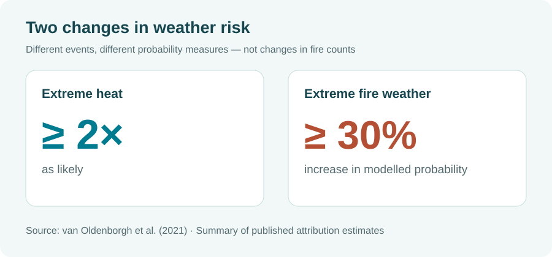

## Why this question matters

Australia's 2019–20 *Black Summer* bushfires left many people asking a difficult question: did climate change cause the disaster? The answer isn't a simple yes or no. A bushfire needs more than hot weather: ignition, vegetation, fuel and local conditions all matter. But scientists can investigate whether climate change made the **weather that favours dangerous fires** more likely.

That is what van Oldenborgh and colleagues studied in southeastern Australia [@vanoldenborgh2021]. They separated three parts of the story: extreme heat, dangerous fire weather and drought. The findings are striking precisely because the evidence is **not equally strong for all three**.

## What did the researchers find?

The researchers combined long-term temperature and rainfall observations, a Fire Weather Index (a measure of weather conditions linked to fire danger) and **11 large ensembles of climate-model simulations**. Rather than claiming to explain every bushfire, they compared how likely extreme weather conditions were under different levels of human-caused warming.

{#fig-evidence width="100%"}

@fig-evidence shows the two findings with quantified changes in likelihood. Extreme heat like that associated with Black Summer had become **at least twice as likely** with long-term warming. Climate-model results also indicated an increase of **at least 30% in the probability of extreme fire-weather conditions**. These are different measures: neither means 30% more fires, nor that fires burned twice as much land.

| Weather factor | What the study found | What this does **not** mean |
|:--|:--|:--|
| Extreme heat | At least twice as likely with long-term warming | Every hot day was caused by climate change |
| Extreme fire weather | Model-based probability increased by at least 30% | 30% more individual bushfires occurred |
| Drought | No attributable human-caused trend detected in the drought measures examined | Climate change has no possible effect on drought |

: What the study can and cannot tell us about Black Summer's weather conditions. Based on van Oldenborgh et al. (2021). {#tbl-findings}

@tbl-findings is the key distinction in one place: a strong signal for heat, a model-based increase in dangerous fire weather, and a less conclusive result for drought.

## Why wasn't the drought finding the same?

The 2019–20 season was exceptionally dry, but the researchers did **not** detect a human-caused trend in the particular drought measures they tested. That does not prove climate change has no influence on drought. It means this study could not establish that influence using those measures. Natural climate patterns also contributed to the dry conditions during 2019.

There is another caution: the climate models reproduced **smaller increases** in extreme heat and fire-weather risk than were seen in observations. The authors therefore treated their model-based fire-weather estimate as conservative, while recognising uncertainty about its exact size.

## What should we take away?

So, did climate change make Black Summer's dangerous conditions more likely? **For extreme heat, the evidence says yes; for extreme fire weather, the models also show an increase.** The drought evidence was less clear. The study does not attribute individual fires to climate change, but it does show that the weather-related risk environment has shifted.

That matters because planning for future fire seasons cannot assume the weather risks of the past have stayed unchanged. The lesson is not that one factor explains everything; it is that understanding each factor helps us prepare more realistically.

## Reference
